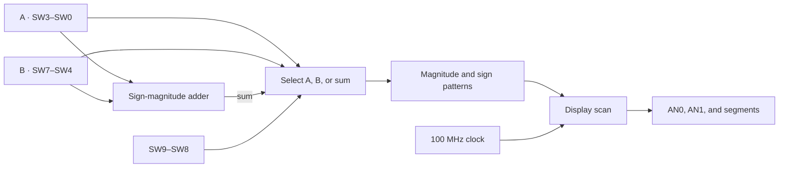
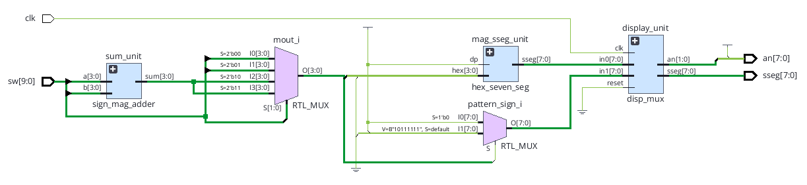

# Nexys A7 Sign-Magnitude Adder

A SystemVerilog FPGA demo for the **Digilent Nexys A7-100T**. Set two signed operands with the slide switches, then use SW9 and SW8 to inspect either operand or their sum on the two rightmost seven-segment digits.

## Board controls

| Switches | Function |
| --- | --- |
| SW3 | Operand A sign |
| SW2–SW0 | Operand A magnitude |
| SW7 | Operand B sign |
| SW6–SW4 | Operand B magnitude |
| SW9–SW8 | Display selection |

| SW9 | SW8 | Display |
| --- | --- | --- |
| 0 | 0 | A |
| 0 | 1 | B |
| 1 | 0 | A + B |
| 1 | 1 | A + B |

Each operand uses one sign bit and three magnitude bits. A sign bit of `1` indicates a negative value. For example, `0011` represents +3 and `1011` represents −3. AN0 displays the magnitude. AN1 shows a minus sign for nonzero negative values and is blank otherwise.

## Architecture



[](docs/images/vivado-rtl-schematic.png)

*Top-level RTL schematic captured in Vivado from the original project. The diagram above summarizes the published revision.*

- [`sign_mag_adder.sv`](rtl/sign_mag_adder.sv) adds magnitudes when signs match. When signs differ, it subtracts the smaller magnitude from the larger and uses the sign of the larger operand.
- [`sign_mag_test.sv`](rtl/sign_mag_test.sv) selects the displayed value and produces the sign pattern. [`hex_seven_seg.sv`](rtl/hex_seven_seg.sv) decodes the magnitude into an active-low segment pattern.
- [`disp_mux.sv`](rtl/disp_mux.sv) alternates the two active-low digit enables every 65,536 cycles of the 100 MHz oscillator. Each digit refreshes at about 763 Hz. The decimal point and the other six digits stay off.
- [`nexys_a7_100t.xdc`](constraints/nexys_a7_100t.xdc) assigns all 27 top-level pins and defines the 10 ns clock. SW8 and SW9 use LVCMOS18.

### Overflow and zero

The display represents integers from −7 through +7. A same-sign sum outside that range wraps the magnitude modulo 8 and retains its sign when the wrapped magnitude is nonzero. For example, +7 + +2 displays `1`, and −7 + −2 displays `-1`. There is no overflow indicator. A zero magnitude always displays `0` with a blank sign, including a negative-zero switch encoding, cancellation, and overflow to zero.

## Build with Vivado

Use AMD Vivado with Artix-7 device support. From the repository root, with Vivado on your path, run:

```sh
vivado -mode batch -nolog -nojournal -source scripts/build.tcl
```

The script targets `xc7a100tcsg324-1` and writes `build/sign_mag_test.bit` plus timing, I/O, and design-rule reports. To build in the Vivado GUI, create an RTL project for the Nexys A7-100T or the same part, add the four `rtl/*.sv` design files and the XDC, set `sign_mag_test` as top, and select **Generate Bitstream**.

## Run the board demo

1. Connect the board's USB-JTAG port labeled **PROG** and power on the board.
2. In Vivado, open **Hardware Manager → Open Target → Auto Connect**.
3. Select the XC7A100T device, choose **Program Device**, and select `build/sign_mag_test.bit` or the bitstream from your GUI project.
4. Set A to `0011` on SW3–SW0 and B to `1010` on SW7–SW4. Step through the four display modes.

| SW9–SW8 | Expected display for A = +3, B = −2 |
| --- | --- |
| `00` | `3` |
| `01` | `-2` |
| `10` | `1` |
| `11` | `1` |

Keep mode `10` and set A to `1011` to see `-5`. Set A to `0010` to see cancellation to `0`.

## Verification

[The self-checking testbench](sim/tb_sign_mag.sv) passed in Vivado Simulator 2026.1. It checks all 256 pairs of operand encodings, including wraparound and both encodings of zero, then checks all 1,024 switch combinations in both display scan phases. From the repository root with the Vivado tools on your path:

```sh
xvlog -sv rtl/disp_mux.sv rtl/hex_seven_seg.sv rtl/sign_mag_adder.sv rtl/sign_mag_test.sv sim/tb_sign_mag.sv
xelab tb_sign_mag -s tb_sign_mag
xsim tb_sign_mag -runall
```

Vivado 2026.1 completed synthesis, placement, routing, and bitstream generation. The routed design reported zero design-rule violations and +7.551 ns worst setup slack against the 100 MHz constraint. Synthesis reports constant outputs for the six disabled digit enables and the decimal point. Physical board verification of this revision is pending.

## References

- Pong P. Chu, *FPGA Prototyping by SystemVerilog Examples*, for the sign-magnitude exercise. [Author's companion materials](https://academic.csuohio.edu/chu-pong/sv-mcs-book/)
- Digilent, for board pin assignments, display behavior, and configuration voltage. [Master XDC](https://github.com/Digilent/digilent-xdc/blob/master/Nexys-A7-100T-Master.xdc) · [Reference manual](https://digilent.com/reference/_media/reference/programmable-logic/nexys-a7/nexys-a7_rm.pdf) · [Schematic](https://digilent.com/reference/_media/reference/programmable-logic/nexys-a7/nexys-a7-sch.pdf)
